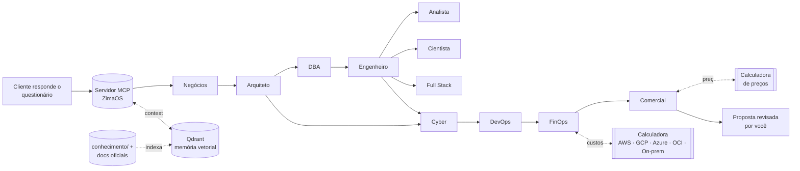

# Cardume — Plataforma de Dados com Agentes

Plataforma para atender clientes de dados do começo ao fim: um **questionário
ramificado** mapeia o negócio, a infraestrutura e o objetivo do cliente; **onze
agentes especialistas** (Negócios, Arquiteto, DBA, Engenheiro, Analista, Cientista,
Full Stack, Cyber, DevOps, FinOps e Comercial) desenham a solução, comparam **AWS,
GCP, Azure, OCI e on-premise** com uma calculadora de custos e montam a proposta com
preço calculado. Os agentes aprendem com uma **base de conhecimento de SGBDs** e com a
documentação oficial, que o servidor baixa e indexa. Tudo
roda num **servidor MCP no ZimaOS**, com **memória vetorial (Qdrant)** e LLM local
(GPU de 6 GB) ou Claude.

> "Cardume" é o nome provisório da marca: um time de especialistas que se move como um só.
> Para trocar, edite `MARCA_NOME` no `.env` e `identidade-visual/tokens.css`.

## Como funciona


## Estrutura
| Pasta | Conteúdo |
|---|---|
| `questionario/` | `questionario.yaml` (fonte), `questionario.html` (app autônomo), `questionario.json` |
| `agentes/` | `AGENT.md` de cada agente + orquestrador (missão, processo, formato de entrega) |
| `skills/` | `SKILL.md` de cada agente + `_clouds/` (AWS, GCP, Azure, OCI, on-premise, equivalências) + referências (Databricks, Snowflake, Git no Engenheiro) |
| `conhecimento/` | Base de conhecimento dos agentes: SGBDs, bancos das clouds e dos ERPs, CDC, backup, segurança, desempenho, migração |
| `servidor/` | Servidor MCP em Python (mcp 2.x): questionário, agentes, custos, preços, memória, coleta de documentação, API web |
| `infra/zimaos/` | `docker-compose.yml`, `.env.example`, `instalar.sh` |
| `docs/` | Visão, modelo de negócio, processos, arquitetura, custos, hardware, MCP, memória, roadmap, LGPD, precificação |
| `identidade-visual/` | Marca, paleta, tipografia, logo (SVG) |
| `instagram/` | Estratégia, calendário de 30 dias, legendas, posts em HTML e PNG |
| `scripts/` | Construir o questionário, empacotar skills, gerar exemplos de preço, baixar documentação oficial, renderizar posts |

## Início rápido (ZimaOS)
```bash
# no terminal do ZimaOS (SSH)
cd /DATA/AppData && git clone <seu-repo> plataforma-src   # ou copie a pasta do Google Drive
cd plataforma-src/plataforma-dados/infra/zimaos
bash instalar.sh                      # núcleo: MCP + Qdrant + Ollama
bash instalar.sh dados automacao      # + PostgreSQL/Metabase e n8n
```
Depois conecte o Claude ao MCP (`docs/07-mcp-zimaos.md`):
```bash
claude mcp add --transport http plataforma http://zima.local:8787/mcp --header "Authorization: Bearer <MCP_TOKEN>"
```

## Fluxo de um cliente novo
1. `cliente_criar` → envie o link do questionário (`http://.../?token=...`) ou conduza por conversa (prompt `discovery_conversado`).
2. Com as obrigatórias respondidas, rode o time: prompt `rodar_time_completo` (Claude atua como cada agente) ou `pipeline_executar`.
3. `preco_estimar` para o preço do projeto e da mensalidade; `proposta_gerar` → revise → envie.
4. Ao fechar o projeto, grave as lições em `memoria_indexar(colecao="projetos")`.

## Ensinar os agentes
1. `memoria_reindexar_base` indexa `docs/`, `agentes/`, `skills/` e `conhecimento/`.
2. `conhecimento_fontes` lista a documentação oficial citada nos arquivos;
   `conhecimento_baixar("sql-server", max_paginas=30)` baixa e indexa uma fonte.
3. Para acrescentar um banco: copie o modelo de `conhecimento/bancos-de-dados/README.md`,
   termine com "## Documentação oficial" e rode os passos 1 e 2.

## Desenvolvimento
```bash
cd servidor && pip install -e ".[dev,anthropic]"
python -m pytest                       # 33 testes
python ../scripts/construir_questionario.py   # após editar o YAML
python ../scripts/gerar_exemplos_preco.py     # após mudar precificacao.yaml ou os exemplos
QDRANT_URL=memoria MODELO_EMBEDDING=hash python -m plataforma.server   # sem Docker
```

## Documentação
- [00 — Visão geral](docs/00-visao-geral.md)
- [01 — Modelo de negócio da consultoria](docs/01-modelo-de-negocio.md)
- [02 — Questionário ramificado](docs/02-questionario.md)
- [03 — Mapa de processos](docs/03-processos.md)
- [04 — Arquitetura](docs/04-arquitetura.md)
- [05 — Clouds e custos](docs/05-clouds-e-custos.md)
- [06 — Hardware e modelos de IA (6 GB de VRAM)](docs/06-hardware-e-modelos-ia.md)
- [07 — Servidor MCP no ZimaOS](docs/07-mcp-zimaos.md)
- [08 — Memória vetorial](docs/08-memoria-vetorial.md)
- [09 — Roadmap de escala](docs/09-roadmap-escala.md)
- [10 — LGPD e contratos da consultoria](docs/10-lgpd-contratos.md)
- [11 — Precificação: quanto cobrar](docs/11-precificacao.md)
- [Base de conhecimento de bancos de dados](conhecimento/bancos-de-dados/README.md)
- [Identidade visual](identidade-visual/marca.md) · [Instagram](instagram/estrategia.md)
