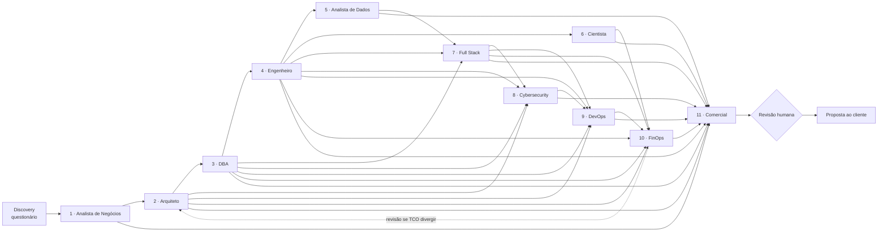

# Orquestrador do time de agentes

O orquestrador não é um décimo segundo especialista: é o processo que coordena os onze,
implementado em `servidor/src/plataforma/orquestrador.py` e exposto pelas
ferramentas MCP `pipeline_executar`, `agente_contexto` e o prompt `rodar_time_completo`.

## Sequência e dependências

## Portões de qualidade
| Portão | Antes de | Critério |
|---|---|---|
| G0 | Analista de Negócios | Obrigatórias do questionário respondidas (`discovery_proximas(apenas_obrigatorias=True)` vazio) |
| G1 | DBA e Engenheiro | Arquitetura com hospedagem decidida e ADR; método de leitura de cada banco aprovado pelo DBA antes da ingestão |
| G2 | DevOps | Controles mínimos do Cyber definidos |
| G3 | Comercial | FinOps sem pedido de revisão aberto; preço calculado com `preco_estimar` |
| G4 | Envio ao cliente | Revisão humana da proposta |

## Regras de conflito
- **Custo × arquitetura**: se a opção recomendada pelo Arquiteto custar mais de 25% acima da mais barata viável, o FinOps pede revisão; o Arquiteto mantém só se citar o requisito que obriga.
- **Segurança × prazo**: controles marcados como obrigatórios pelo Cyber não saem do MVP; o Comercial ajusta prazo ou escopo.
- **Escopo × orçamento**: o Comercial corta escopo preservando a pergunta de negócio principal.
- **Carga no banco de produção × frescor**: o DBA define a janela e o método de leitura; o Engenheiro ajusta a latência ao que o DBA liberar.
- **Aplicação sob medida × ferramenta pronta**: o Full Stack só propõe software quando painel, planilha ou formulário pronto não resolvem.

## Modos de execução
1. **Assistido (recomendado com GPU de 6 GB)**: `LLM_BACKEND=nenhum`. Você usa Claude (Desktop/Code/claude.ai) conectado ao MCP; para cada agente, `agente_contexto` → Claude raciocina → `entregavel_salvar`. A GPU local fica só com embeddings.
2. **Local**: `LLM_BACKEND=ollama` (`qwen3:4b`). Bom para rascunhos e testes; revise antes de enviar.
3. **API**: `LLM_BACKEND=anthropic` com `ANTHROPIC_API_KEY`. Qualidade máxima, custo de centavos a poucos dólares por cliente.
4. **Misto**: rascunho local dos agentes 1–9 e API para FinOps e Comercial (`pipeline_executar(agentes=[...], backend=...)`).

## Conhecimento de cada agente
Além das consultas fixas, cada agente recebe no perfil a lista dos seus arquivos de
`conhecimento/` (campo `conhecimento` em `agentes.py`). O DBA e o Engenheiro também
buscam na memória os trechos dos bancos, do ERP e da plataforma de dados que o
cliente marcou no questionário; o Comercial recebe a tabela de preços da calculadora.

## Memória entre projetos
Ao fechar um projeto, grave as lições na coleção `projetos` (`memoria_indexar`):
segmento, porte, cloud escolhida, custo real × estimado, o que deu errado, o que
repetir. Os próximos discoveries do mesmo segmento recebem esse conhecimento automaticamente.

## Formato de entrega
O orquestrador consolida tudo em `proposta_gerar`: objetivo, perguntas de negócio,
resumo comercial, comparativo de custos e o entregável mais recente de cada agente,
com a lista de pendências.
