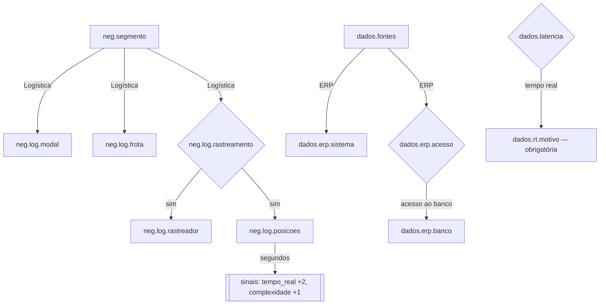

# 02 — Questionário ramificado

## Números
- **11 seções**, **214 perguntas**, **709 opções**.
- **135 perguntas condicionais**: só aparecem por causa de uma escolha anterior.
- Até **3 níveis** (pergunta → subpergunta → sub-subpergunta).
- Um cliente típico vê de 70 a 110 perguntas, em 25–40 minutos.

## Seções
| # | Seção | O que mapeia | Agentes que mais usam |
|---|---|---|---|
| 0 | Identificação | Empresa, contato, papel na decisão, origem do lead | Comercial |
| 1 | Modelo de Negócio | Segmento (13 ramos com perguntas próprias), receita, porte, unidades, áreas e dores, KPIs atuais, sazonalidade, regulação | Negócios, Arquiteto, Cientista |
| 2 | Maturidade e Pessoas | Nível de maturidade 1–5, time de dados e competências, TI, patrocinador, quem opera depois | Arquiteto, DevOps, Comercial |
| 3 | Dados e Fontes | ERP (13 sistemas, como acessar, banco), CRM, bancos, planilhas, e-commerce, marketing, IoT, documentos/NF-e, dados públicos; volume, crescimento, latência, histórico, qualidade, dados pessoais | Engenheiro, Arquiteto, FinOps, Cyber |
| 4 | Infraestrutura | On-premise/cloud/híbrido (com detalhes de cada), Microsoft 365, Google Workspace, link, preferência, restrições, RTO/RPO, ambientes | Arquiteto, DevOps, FinOps |
| 5 | Consumo e Analytics | BI, número e perfil de usuários, clientes externos, RLS, alertas, API, perguntas em linguagem natural | Analista, FinOps |
| 6 | IA e Ciência de Dados | Estágio, casos de uso (15), dados rotulados, privacidade de LLM, explicabilidade | Cientista, Cyber, FinOps |
| 7 | Automação | Processos, ferramentas atuais, horas manuais e custo/hora (ROI), WhatsApp | Engenheiro, Comercial |
| 8 | Segurança e Compliance | Certificações, DPO, incidentes, SSO, MFA, backup, acesso remoto, auditoria | Cyber, DevOps |
| 9 | Orçamento e Contratação | Orçamento de infra e de projeto, modelo de contratação, prazo, processo de compra | Comercial, FinOps |
| 10 | Objetivo da Plataforma | **Objetivo em texto livre, 3–5 perguntas de negócio**, entregas esperadas, KPI de sucesso em 90 dias, prioridade, horizonte, riscos | Todos |

## Como a ramificação funciona
Dois mecanismos, definidos no YAML:

1. **Subperguntas dentro de uma opção** — escolher a opção abre as perguntas filhas:
```yaml
- id: neg.segmento
  tipo: unica
  opcoes:
    - valor: seguros_protecao
      rotulo: "Seguros / Proteção veicular"
      subperguntas:
        - id: neg.seg.tipo
          ...
```
2. **`mostrar_se`** — condição cruzada com qualquer resposta, inclusive de outra seção:
```yaml
- id: infra.onprem.servidores
  mostrar_se: {pergunta: infra.atual, em: [on_premise, hibrido]}
```
Também aceita `preenchida: true`, `maior_que: N`, `qualquer: [...]`, `todas: [...]` e `nao: {...}`.

Atalho `tipo: sim_nao` com `se_sim:` e `se_nao:` para os dois ramos.

Exemplo de caminho:


Quando o cliente troca uma resposta, os ramos que deixam de valer somem da tela
(e são descartados ao salvar), mas ficam guardados no rascunho enquanto ele edita —
se voltar à escolha anterior, as respostas reaparecem.

## Sinais
Opções podem somar pontos em `sinais` — afinidade com `aws`, `gcp`, `azure`, `oci`,
`onprem` e intensidade de `complexidade`, `risco`, `ia`, `automacao`, `tempo_real`.
O painel lateral do app mostra os sinais em tempo real; a calculadora de custos usa
a afinidade no ranking e os agentes recebem os totais no contexto.

## Três formas de responder
1. **App web** servido pelo próprio servidor: `http://zima.local:8787/?token=...` — o cliente responde no navegador; salva no servidor a cada pausa, e no aparelho se a conexão cair.
2. **App autônomo** (`questionario/questionario.html`): abre offline, guarda no aparelho, exporta JSON para importar com `discovery_importar`.
3. **Conversa** com o Claude conectado ao MCP: prompt `discovery_conversado` — o Claude faz uma pergunta por vez com `discovery_proximas`/`discovery_responder`.

## Como editar
1. Edite `questionario/questionario.yaml` (mantenha os `id` estáveis: os agentes e a calculadora usam alguns deles).
2. Rode `python scripts/construir_questionario.py` para atualizar o app autônomo e o JSON.
3. Rode os testes (`cd servidor && python -m pytest`) — eles checam ids, referências cruzadas e valores.
4. O servidor relê o YAML sozinho quando o arquivo muda.

Cuidados: valores de opção sempre como texto (`"11_50"` entre aspas — sem aspas o YAML
lê como número); ids no formato `secao.assunto.detalhe`.
