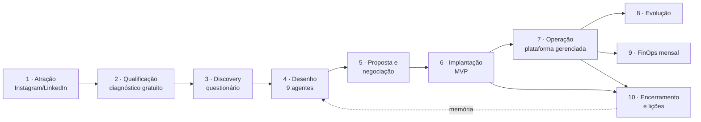
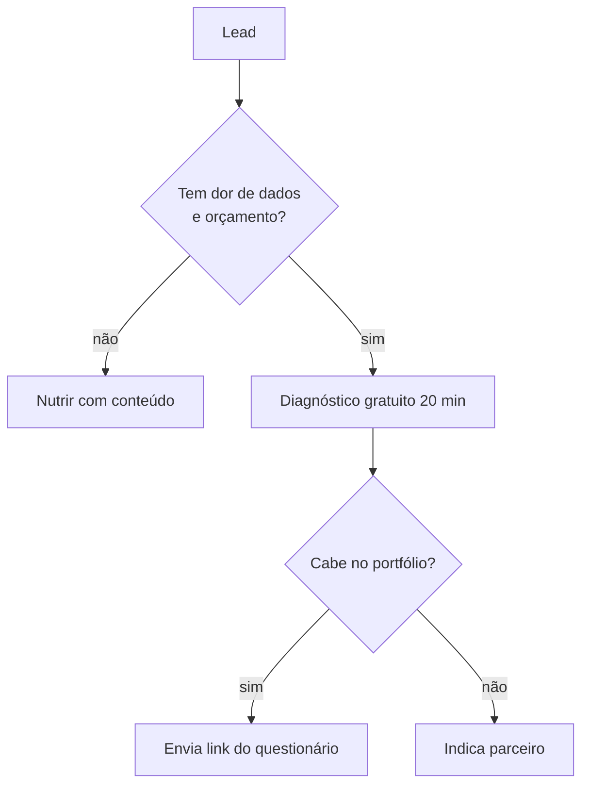
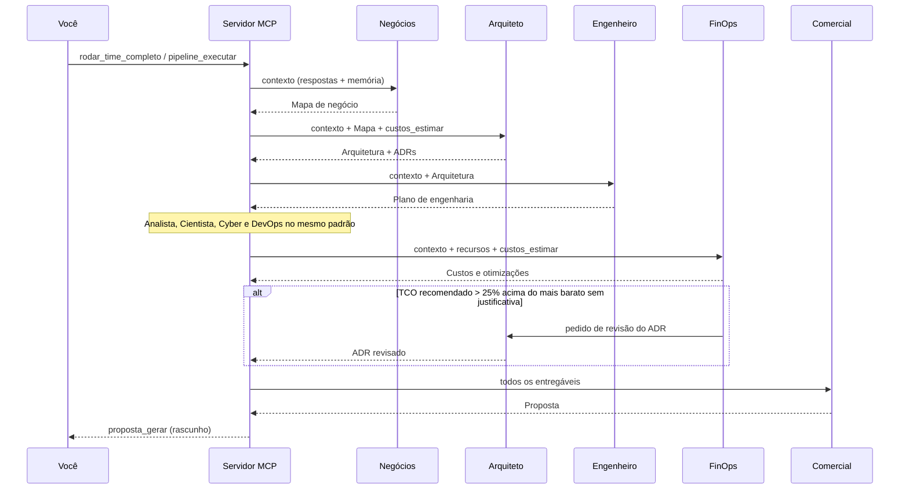
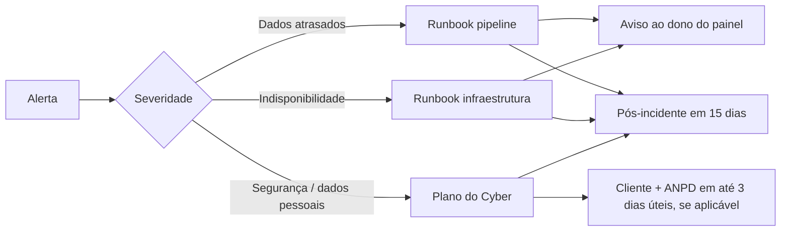

# 03 — Mapa de processos

Todos os processos da consultoria, com quem executa (você, cliente, agentes,
automações) e o que sai de cada etapa.

## Visão de ponta a ponta

## 1. Atração (marketing)
| Etapa | Quem | Ferramenta | Saída |
|---|---|---|---|
| Planejar o mês | Você + Comercial | `instagram/calendario-30-dias.md` | 12–16 posts planejados |
| Produzir arte | Você (ou Claude) | Templates HTML + `scripts/renderizar_posts.py` | PNG 1080×1350 |
| Publicar | Você (ou agendador) | Instagram / Postiz | Post no ar |
| Responder DMs e comentários | Você | Instagram | Lead com nome e WhatsApp |
| Registrar lead | n8n | Webhook → planilha/CRM | Lead no funil |
| Guardar post na memória | Você | `memoria_indexar(colecao="marca")` | Tom de voz consistente |

## 2. Qualificação

Critérios: faturamento ≥ R$ 2 milhões ou dor clara com valor ≥ R$ 3 mil/mês; decisor
identificado; prazo ≤ 6 meses.

## 3. Discovery
| Etapa | Quem | Ferramenta MCP | Saída |
|---|---|---|---|
| Cadastrar cliente | Você | `cliente_criar` | slug |
| Enviar questionário | Você | link `/?token=` (ou túnel público) | Cliente respondendo |
| Acompanhar progresso | Você | `discovery_resumo` | % concluído, obrigatórias faltando |
| Completar lacunas em reunião | Você + cliente | prompt `discovery_conversado` | Questionário completo |
| Portão G0 | Orquestrador | `discovery_proximas(apenas_obrigatorias=True)` vazio | Liberado para os agentes |

## 4. Desenho (time de agentes)

## 5. Proposta e negociação
| Etapa | Quem | Saída |
|---|---|---|
| Revisar a proposta (portão G4) | Você | Proposta aprovada |
| Apresentar (30–45 min) | Você | Dúvidas e objeções |
| Ajustar cenário | FinOps/Comercial (`custos_estimar` com parâmetros) | Nova versão |
| Fechar | Você + cliente | Contrato + DPA assinados |

## 6. Implantação do MVP (30–60 dias)
| Semana | Atividade | Responsável |
|---|---|---|
| 1 | Acessos (usuário de leitura, VPN/túnel), repositório, ambiente base (IaC) | DevOps + Cyber |
| 2–3 | Ingestão da 1ª fonte, bronze/silver, testes | Engenheiro |
| 3–4 | Marts da gold, camada semântica | Engenheiro + Analista |
| 4–5 | Painéis do MVP, validação de números com os donos | Analista + cliente |
| 5–6 | Alertas, treinamento, go-live, runbooks | DevOps + Analista |
Critério de aceite: as perguntas de negócio do MVP respondidas com números validados pelo cliente.

## 7. Operação (plataforma gerenciada)
| Rotina | Frequência | Quem | Automação |
|---|---|---|---|
| Monitorar pipelines e frescor | contínuo | DevOps | Alertas Dagster/n8n → WhatsApp |
| Tratar falhas | sob demanda | Engenheiro | Runbook |
| Backup e teste de restauração | diário / mensal | DevOps | restic + verificação |
| Atualizações de segurança | mensal | DevOps + Cyber | Janela combinada |
| Reunião de resultados | mensal | Você + cliente | Painel de uso + KPIs |
| Pequenas evoluções | horas do pacote | Engenheiro/Analista | — |

## 8. Evolução
Novas fontes, painéis, IA e automações entram por ordem de mudança ou banco de
horas; cada uma passa pelo agente relevante (ex.: nova fonte → Engenheiro → Cyber →
FinOps se mudar custo).

## 9. FinOps mensal
1. Exportar custos (FOCUS) da cloud do cliente ou rateio do ZimaOS.
2. Comparar com o orçamento aprovado; alertas em 50/80/100%.
3. Aplicar as otimizações pendentes da lista do FinOps.
4. Relatar ao cliente custo do mês, custo unitário e economia gerada.

## 10. Incidentes

## 11. Encerramento e lições
1. Entregar repositório, documentação e dados em formato aberto (cláusula de saída).
2. Registrar lições: `memoria_indexar(colecao="projetos", origem="<slug>-licoes")` com segmento, porte, cloud, custo estimado × real, o que repetir e o que evitar.
3. Pedir depoimento/indicação (vira conteúdo do Instagram, com autorização).

## Matriz RACI (R = executa, A = aprova, C = consultado, I = informado)
| Processo | Você | Cliente | Negócios | Arquiteto | Engenheiro | Analista | Cientista | Cyber | DevOps | FinOps | Comercial |
|---|---|---|---|---|---|---|---|---|---|---|---|
| Discovery | A | R | C | C | | | | | | | I |
| Mapa de negócio | A | C | R | I | I | I | I | | | | I |
| Arquitetura | A | I | C | R | C | | | C | C | C | |
| Plano de engenharia | A | C | | C | R | I | I | C | I | | I |
| Painéis | A | C | C | | C | R | | C | | I | |
| IA | A | C | C | C | C | C | R | C | | C | I |
| Segurança/LGPD | A | C | | C | C | | C | R | C | | I |
| Infra e operação | A | I | | C | C | | | C | R | C | I |
| Custos | A | I | | C | | | | | C | R | C |
| Proposta | A | I | C | C | C | C | C | C | C | C | R |
| Implantação | A | C | | C | R | R | | C | R | I | I |
| Operação | A | I | | | R | R | | C | R | C | |
