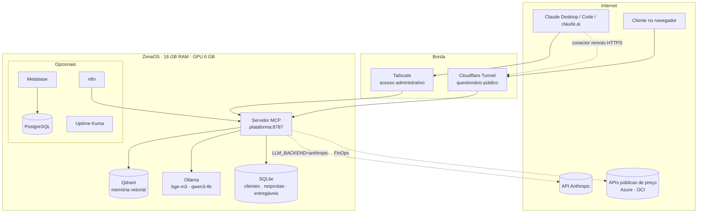
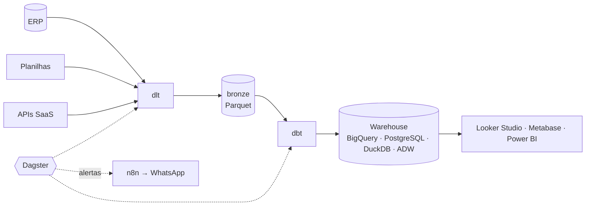
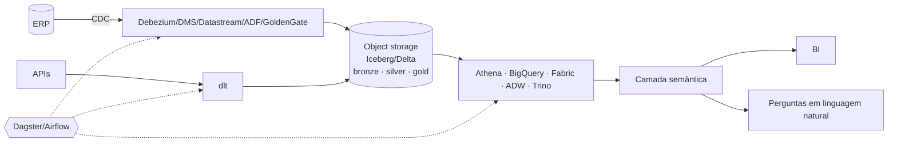

# 04 — Arquitetura

Dois níveis de arquitetura:
1. **A plataforma da consultoria** (onde os agentes trabalham) — roda no ZimaOS.
2. **A plataforma de dados de cada cliente** — desenhada pelos agentes; pode rodar em qualquer cloud ou on-premise.

## 1. Plataforma da consultoria (ZimaOS)

### Componentes do servidor MCP (`servidor/src/plataforma/`)
| Módulo | Responsabilidade |
|---|---|
| `questionario.py` | Carrega o YAML, calcula visibilidade, normaliza respostas, soma sinais, gera resumos por agente |
| `custos.py` + `dados/precos.yaml` | Calculadora determinística AWS/GCP/Azure/OCI/on-premise, ranking e premissas |
| `vetorial.py` | Embeddings (Ollama ou hashing), Qdrant (REST) ou memória, fragmentação, isolamento por cliente |
| `agentes.py` | Registro dos 9 agentes: ordem, dependências, consultas à memória |
| `orquestrador.py` | Monta contexto de cada agente, roda o pipeline, salva e indexa entregáveis, gera a proposta |
| `llm.py` | Backends: Ollama local, Claude via API, ou nenhum (o cliente MCP raciocina) |
| `store.py` | SQLite: clientes, discovery, entregáveis, execuções |
| `server.py` | 23 ferramentas MCP, 3 prompts, recursos, rotas web e API REST, autenticação por token |
| `web/questionario.html` | App do questionário (o servidor injeta o JSON) |

### Ferramentas MCP
| Grupo | Ferramentas |
|---|---|
| Saúde | `plataforma_saude` |
| Questionário | `questionario_estrutura`, `discovery_proximas`, `discovery_responder`, `discovery_importar`, `discovery_resumo` |
| Clientes | `cliente_listar`, `cliente_criar` |
| Agentes | `agente_listar`, `agente_perfil`, `agente_contexto`, `entregavel_salvar`, `entregavel_listar`, `entregavel_obter`, `pipeline_executar`, `pipeline_status` |
| Custos | `custos_estimar`, `precos_azure_consultar`, `precos_oci_consultar` |
| Memória | `memoria_buscar`, `memoria_indexar`, `memoria_reindexar_base` |
| Proposta | `proposta_gerar` |

Prompts: `discovery_conversado`, `atuar_como_agente`, `rodar_time_completo`.
Recursos: `plataforma://questionario`, `plataforma://agentes/{agente}`, `plataforma://clientes/{slug}/proposta`.

### Orçamento de memória (16 GB)
| Serviço | RAM | Observação |
|---|---|---|
| ZimaOS + Docker | ~1,5 GB | |
| Servidor MCP | ~0,2–0,5 GB | limite de 1 GB no compose |
| Qdrant | ~0,3–1 GB | vetores int8 na RAM, originais em disco |
| Ollama (fora da VRAM) | ~1–2 GB | pesos ficam na VRAM de 6 GB |
| PostgreSQL + Metabase (perfil dados) | ~2,5 GB | Metabase com `-Xmx1g` |
| n8n (perfil automacao) | ~0,4 GB | |
| Folga para pipelines de clientes (dlt/dbt) | 4–6 GB | rodam sob demanda |

## 2. Plataforma de dados do cliente (referência)
O Arquiteto escolhe entre os padrões abaixo; os detalhes por cloud estão em `skills/_clouds/`.

### Porte P — warehouse-first

Custo típico: R$ 0–1.500/mês (o maior item costuma ser licença de BI).

### Porte M — lakehouse

### Porte G — lakehouse com streaming
Adiciona Kafka/Kinesis/Pub/Sub/Event Hubs/OCI Streaming, processamento em Spark
gerenciado e warehouse com concorrência alta; só quando `dados.rt.motivo` justificar.

## 3. Decisões de arquitetura da plataforma (ADRs)
- **ADR-P01 — MCP como interface única**: qualquer cliente MCP (Claude, Open WebUI, n8n) usa as mesmas ferramentas; evita construir uma interface própria agora.
- **ADR-P02 — Calculadora determinística**: LLM pequeno erra contas; custos vêm de código com premissas explícitas.
- **ADR-P03 — Qdrant com quantização int8 e vetores em disco**: cabe em 16 GB e escala para milhões de trechos; multi-inquilino com o campo `cliente` marcado como tenant.
- **ADR-P04 — SQLite para estado**: dezenas de clientes não justificam um servidor de banco; arquivo único simplifica backup.
- **ADR-P05 — Modo assistido como padrão (`LLM_BACKEND=nenhum`)**: com 6 GB de VRAM, o raciocínio pesado fica no Claude conectado ao MCP; a GPU faz embeddings e rascunhos.
- **ADR-P06 — Formatos abertos nos clientes**: Parquet/Iceberg, dbt e Dagster permitem migrar entre clouds e sair da consultoria sem reescrever.
