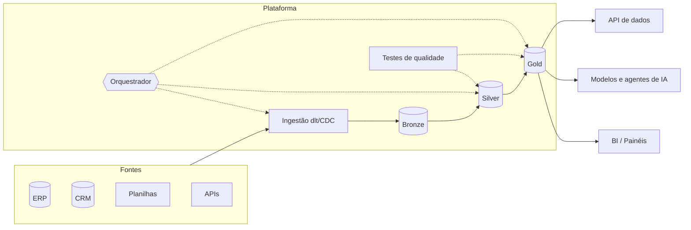

# Skill — Arquiteto de Dados

## Classificação de porte (igual à calculadora)
| Porte | Volume | Usuários BI | Latência | Fontes |
|---|---|---|---|---|
| P | até ~200 GB | até 50 | D-1 / algumas vezes ao dia | até 7 |
| M | até ~10 TB | até 500 | horária / micro-lotes | 8+ |
| G | acima de 10 TB | 500+ | streaming (segundos) | muitas, com CDC |

## Matriz de decisão de hospedagem (ordem importa)
1. **Restrições eliminatórias**: `sem_saas`/`air_gapped` → on-premise; `dados_brasil` → só regiões BR; `neg.fin.bacen` → provedor com contrato e auditoria compatíveis com a Res. 4.893 (todas as quatro atendem com configuração adequada); `ia.llm_privacidade = local` → GPU própria ou dedicada.
2. **Custo (TCO 12 meses)** da calculadora (`custos_estimar`), incluindo operação.
3. **Afinidade** (sinais): o que o cliente já usa e sabe operar reduz risco e prazo.
4. **Requisitos não funcionais**: RTO/RPO, picos, crescimento, número de usuários.
5. **Prioridade declarada** (`obj.prioridade`): custo, velocidade, escala, segurança ou autonomia.

Pesos sugeridos: custo 40, afinidade 25, requisitos 25, prioridade 10 (ajuste à prioridade do cliente e explique).

## Padrões de arquitetura
- **Warehouse-first (porte P)**: fontes → ELT (dlt) → warehouse (BigQuery / PostgreSQL / DuckDB / ADW) → dbt → BI. Menos peças, menor custo.
- **Lakehouse (porte M/G)**: object storage + tabela aberta (Iceberg/Delta) + motor SQL (Athena, BigQuery/BigLake, Fabric, Trino) + dbt. Separa armazenamento de computação e evita lock-in.
- **Medalhão**: bronze (bruto, imutável, particionado por data de carga), silver (limpo, tipado, deduplicado, chaves de negócio), gold (modelos dimensionais e métricas prontas para o BI).
- **Lambda/Kappa** só com justificativa: prefira micro-lotes de 5–15 minutos antes de streaming verdadeiro; streaming custa 5–20× mais para operar.
- **Híbrido**: coleta on-premise (agente/túnel junto ao ERP) + processamento em cloud; ou cloud para BI e on-premise para dados sensíveis.

## Modelagem
- Gold em **estrela**: fatos com granularidade explícita (uma linha = um item de pedido, um sinistro, um evento GPS agregado por hora) e dimensões conformadas (cliente, produto, tempo, unidade, vendedor).
- SCD tipo 2 para dimensões que mudam e afetam análise histórica (carteira do vendedor, plano do associado).
- **Chave mestra** de cliente/produto entre sistemas: se não existir (`sem_chave`), prever tabela de correspondência e regras de match.
- Multi-empresa/multi-CNPJ: coluna de empresa em todos os fatos e RLS no BI.

## Stacks por cloud (detalhe nos guias)
- AWS: `skills/_clouds/aws.md` — S3 + Athena/Redshift Serverless + dbt + Dagster/MWAA + QuickSight.
- GCP: `skills/_clouds/gcp.md` — BigQuery + Dataform/dbt + Cloud Run Jobs + Looker Studio.
- Azure: `skills/_clouds/azure.md` — ADLS/OneLake + Fabric/Synapse + Data Factory + Power BI.
- OCI: `skills/_clouds/oci.md` — Object Storage + ADW/PostgreSQL em A1 + Data Flow + Superset.
- On-premise/ZimaOS: `skills/_clouds/on-premise.md` — PostgreSQL/DuckDB + dlt + dbt + Dagster + Metabase.
- Equivalências: `skills/_clouds/equivalencias.md`.

## Template de ADR
```
### ADR-00N — <decisão>
Status: proposta | aceita | substituída
Contexto: <requisitos e restrições que forçam a decisão>
Decisão: <o que foi escolhido>
Alternativas consideradas: <opção — por que não>
Consequências: <positivas, negativas, custo, risco de lock-in, gatilho para revisitar>
```

## Diagrama base (Mermaid)


## Antipadrões
- Escolher Spark/Databricks para 50 GB.
- Streaming para um painel que a diretoria abre uma vez por dia.
- Um banco por painel; regras de negócio duplicadas no BI e no SQL.
- Ignorar saída de internet e NAT no custo (AWS/Azure/GCP).
- Lock-in sem motivo: formatos proprietários quando Parquet/Iceberg servem.
